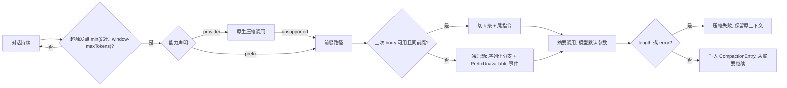
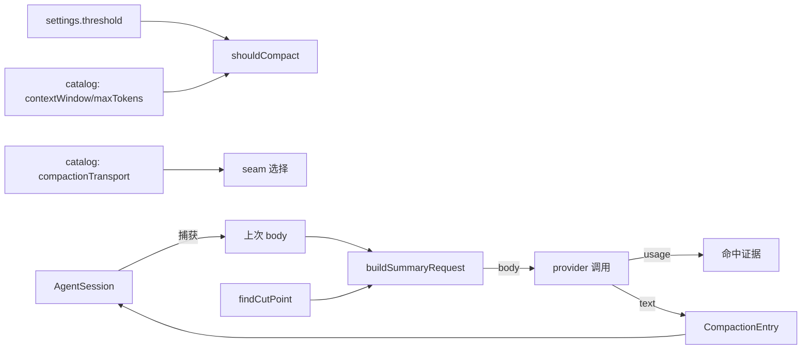
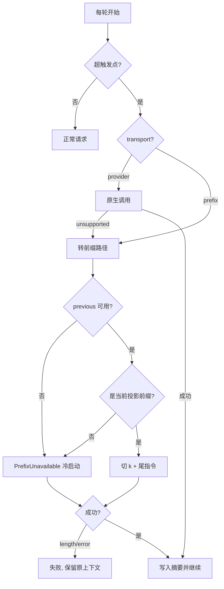

# S1-01 方案决策：压缩能力 seam（原生压缩 / 前缀命中）

> 正式 Issue：S1-01（`issue-register` 派生，registration commit `0340904c`）。原始需求：`S1-01_原始需求.md`（`S1-01-requirement-v1`）。

目标：**质量不降的前提下尽可能省费用**。摘要请求不改，沿用模型默认。

## 1. 问题与目标

**事实**：

- 压缩摘要请求使用独立 system prompt + `serializeConversation` 文本 + tool result 截断（`compaction.ts:718-735`、`utils.ts:98-111`），与上次请求零公共前缀，命中率 0%。DS 1M 上下文、`v4-pro` 高峰下一次压缩输入约 8.6 元。
- 触发用绝对保留量 `contextTokens > contextWindow - reserveTokens`（`compaction.ts:267-270`，默认 16384，`:126`）。等价比例随窗口漂移：32K 为 50%，1M 为 98.4%。
- DeepSeek 无服务端压缩：`context_management`、`previous_response_id`、`store` 均 Not supported（官方 Responses API 兼容表）；Anthropic 有 `compaction: { type: "summarize" }` beta（SDK 类型 `BetaCompactionConfig`）。

**目标**：

1. 压缩能力按两套真实机制组织：**provider 原生远程压缩**优先；不支持时用**前缀命中的客户端摘要**。
2. 触发规则统一为「95% 与模型自身限额，谁先到用谁」。
3. 摘要请求的模型参数保持默认。

**未知**：`deepseek-v4-pro` 未做前缀实测（flash 已实测）。

## 2. 用户决策与裁决结果

| 问题 | 结果 | 依据 |
|---|---|---|
| 摘要 `maxTokens` / thinking | 不改，沿用模型默认 | 用户决定 |
| 压缩能力组织方式 | 两套机制并存：原生优先，前缀兜底 | 用户决定；两套机制都是真实存在的，构成真 seam |
| 触发规则 | 95% 与模型限额取先到者 | 用户决定 |
| 是否引入 tool-result pruner | 不引入 | 命中价下为负收益 |
| 是否修 `deepseek-flash` 系统性全价 miss | 不修，登记优化候选 | 实测 flash 静默忽略中段 system |
| 是否持久化上次请求体 | 不持久化 | session 体积；恢复后仍需重建等价性 |

**已知代价，用户接受**：DS 1M 窗口、`maxTokens` 384K 时，「模型限额」一侧先到，触发点落在 616K（61.6%）而非 950K。这是「谁先到用谁」的必然结果。

## 3. 业务范围与验收目标

范围：`packages/ai` 增加确定性 wire body 构造与压缩能力声明；`packages/coding-agent` 拆出压缩能力 seam 与前缀实现；触发改为比例 + 模型限额；既有 11 个压缩测试迁移；`docs/compaction.md` 增补。

验收：

1. 同一会话连续两次前缀压缩，第二次请求消息是第一次的前缀（测试断言）。
2. 摘要请求不含独立 summarizer system prompt、不含序列化文本。
3. 摘要请求参数与直接对话一致（不新增 `max_tokens` / `reasoning` 覆盖）。
4. 触发点 = `min(contextWindow × 0.95, contextWindow − maxTokens)`，32K 与 1M 窗口比例语义一致（测试断言）。
5. 能力选择：声明原生压缩的 provider 走原生路径；未实现时返回 `unsupported` 而非静默降级；未声明的走前缀路径。
6. 上次请求缺失或失效 → `PrefixUnavailable` → 冷启动序列化分支，UI 事件可见原因。
7. 实测证据：同前缀对照命中 ≥ 90%。

## 4. 架构方向

**触发不变式**（一个参数 + 一条模型事实）：

> 触发点 = `min(contextWindow × threshold, contextWindow − maxTokens)`，`threshold` 默认 `0.95`，对所有模型相同；provider 报 context-overflow 时作为反应式触发兜底。

**压缩能力 seam**（两套真实机制 → 真 seam）：

> 同一个 `compact()` 能力，两个 Adapter：
> - `provider`：调用 provider 原生压缩（Anthropic `compaction` beta 等），返回不透明恢复状态；
> - `prefix`：重放上次请求前缀 + 尾部指令，产出摘要文本。
> 选择依据是 catalog 声明的静态能力，不靠运行时试探；声明为 `provider` 但本 Issue 未实现的，返回 `unsupported`，不静默降级。

**前缀不变式**（`prefix` Adapter 内部，两侧都要满足）：

> 摘要请求 = 上一次实际发出的消息数组的前 `k` 条 + 一条尾部 user 指令；`k` 由切割点决定；这 `k` 条与当前上下文的同一前缀逐字节相同。

我上一轮说「不引入 seam」是基于只有一套机制；现在有两套真实机制，按 codebase-design 的「two adapters means a real seam」，seam 成立。

## 5. Module / capability 责任方向

| 层 | Module | Interface | 责任 |
|---|---|---|---|
| pi-ai | 请求构造 | `buildChatBody(model, context): ChatBody \| null` | 折叠、工具解析、compat 全隐藏；确定性；非支持 api 返回 `null` |
| pi-ai | 压缩能力声明 | catalog 字段 `compactionTransport: "provider" \| "prefix"` | 静态声明，不探测 |
| coding-agent | 压缩能力 seam | `compact(capability, input): CompactOutcome` | 选择 Adapter；`provider`/`prefix` 两个实现；`unsupported` 显式返回 |
| coding-agent | 前缀 Adapter | `buildSummaryRequest(previous, k, instruction): ChatBody` | 切片、追加、两侧校验、`PrefixUnavailable` |
| coding-agent | 触发判定 | `shouldCompact(contextTokens, model, settings): boolean` | `min(ratio, 模型限额)` |
| coding-agent | 压缩编排 | 现有 `generateSummaryWithUsage` | 消费 seam；冷启动走序列化分支 |

- Adapter：`provider`（本 Issue 只声明 + 返回 `unsupported`，交付另立 Issue）、`prefix`（本 Issue 交付）。
- 删除测试：删掉 seam 与两个 Adapter，调用方必须自己判断 provider 能力并各写一套请求构造 → 复杂度回到调用方，seam 成立。
- 文件布局（一概念一文件）：
  - 新 `packages/ai/src/api/openai-completions-body.ts`（`openai-completions.ts` 1728 行拆出）
  - 新 `packages/coding-agent/src/core/compaction/transport.ts`（seam + 选择）
  - 新 `packages/coding-agent/src/core/compaction/prefix.ts`（前缀 Adapter）
  - 新 `packages/coding-agent/src/core/compaction/provider-compaction.ts`（原生 Adapter 声明，返回 `unsupported`）
  - `compaction.ts` 只保留切割点、触发与编排

## 6. 数据真源与依赖方向

| 数据 | 真源 | 生产者 | 消费者 | 生命周期 |
|---|---|---|---|---|
| 上一次发出的 body | `AgentSession` 实例字段 | 摘要前捕获 | `buildSummaryRequest` | 进程内；换模型/工具集即失效 |
| 切割点 `k` | `findCutPoint()` | `prepareCompaction` | 前缀 Adapter | 单次压缩 |
| 触发阈值 | `settings.json` 的 `compaction.threshold` | settings manager | `shouldCompact` | 配置生命周期 |
| 模型限额 | catalog `contextWindow` / `maxTokens` | 既有 model 事实 | `shouldCompact` | 静态 |
| 能力声明 | catalog `compactionTransport` | 同上 | seam 选择 | 静态 |
| 命中证据 | provider `usage.prompt_cache_hit_tokens` | usage 记录 | UI 与测试 | 会话持久 |

依赖方向单向：`compaction/*` → `@earendil-works/pi-ai`。

## 7. 工作范围与依赖方向

允许：`packages/ai/src/api/openai-completions-body.ts`、`packages/ai/src/index.ts`、`packages/coding-agent/src/core/compaction/{transport.ts,prefix.ts,provider-compaction.ts,compaction.ts}`、`packages/ai/catalog/**`（新增能力字段）、settings 文件、相关测试、`docs/compaction.md`。

禁止：改 `ProviderStreams` 接口、改摘要请求的模型参数、改 flash 折叠行为、`provider` Adapter 的真实调用（另立 Issue）。

真实依赖：无前置 Issue；测试门禁为本票全部压缩测试通过。

## 8. 性能与执行面方向约束

- 每轮多一次 `buildChatBody` 装配（纯计算）；触发判定纯函数。
- 内存：持有上次 body 的数组引用，不复制文本。
- 远端调用次数与现状相同（每次压缩一次）；`provider` Adapter 实现后同样一次调用，但输入由 provider 侧的会话缓存承担。
- 摘要 token 预算不变（模型默认）。

## 9. ADR 动作方向

新增 `docs/02_架构决策记录/ADR-001_压缩能力seam与前缀不变式.md`：记录两套机制的 seam 划分、能力声明与 fail-closed 规则、触发取先到者、前缀两侧不变式、不做持久化的理由。由 `architecture-design` 起草，批准后生效。

## 10. Legacy 承接方向

| 事实 | 影响 | owner | 关闭条件 |
|---|---|---|---|
| `provider` Adapter 未实现 | 声明原生压缩的 provider 会得到 `unsupported` | 后续 Issue | 原生 Adapter 交付并通过回放测试 |
| DS 上「谁先到」落在 61.6%，不是 95% | 压缩更早更频繁 | 已接受 | 若改为「provider 报错才算限额」，重新决策 |
| 95% 对小窗口 32K 只剩 1.6K 输出 | 长回答可能 400 | 后续决策 | 出现真实失败样本再评估 |
| flash 折叠导致补丁全量 miss | 每轮可能全价 | 后续决策 | DS 支持中段 system，或长会话用 v4-pro |
| pruner 负收益 | 已否决 | 不再跟进 | provider 定价改为未命中主导时重评 |
| `v4-pro` 未实测 | 按同一不变式适用 | 本票测试补齐 | 补一组实测证据 |

## 11. 业务流程图



## 12. 数据流程图



## 13. 逻辑设计图



## 14. 配置与可执行闭环

| 项 | 真源 | 默认 | 覆盖 | 校验 |
|---|---|---|---|---|
| `compaction.enabled` | `settings.json` | `true` | 项目覆盖用户 | 布尔 |
| `compaction.threshold` | `settings.json` | `0.95` | 项目覆盖用户 | `0 < x < 1`，区间外拒绝 |
| `compaction.keepRecentTokens` | `settings.json` | `20000` | 项目覆盖用户 | 非负安全整数 |

删除 `compaction.reserveTokens` 与 `modelOverrides.*.reserveTokens`（含 schema、文档、测试）。`modelOverrides` 保留 `keepRecentTokens` 等仍存在字段。

可执行：入口 `compaction/transport.ts`；运行 `npm run check`；测试见 §18；完成判据为测试通过 + 命中证据 ≥ 90%。

## 15. 迁移与兼容设计

| 原行为 | 新行为 | 兼容窗口 | 删除责任 |
|---|---|---|---|
| `buildSummarizationContext` 换 system prompt | 前缀路径复用会话 system，指令后置 | 无（内部） | 本票删除 |
| `serializeConversation` 用于所有摘要 | 仅冷启动分支 | 保留 | 收窄调用点 |
| `reserveTokens` 绝对保留量 | `threshold` 比例 + 模型限额取先到 | 无（不保留旧键） | 本票删除 |
| 单一摘要实现 | seam + 两个 Adapter | `provider` 未实现返回 `unsupported` | 本票声明 |
| 摘要用模型输出上限 | 保持 | — | 无变化 |

`session_before_compact` 的 `preparation.settings` 由 `reserveTokens` 改为 `threshold`，属内部类型同步。

## 16. 原子方案切片与 Implementation Items

```json
[
  {
    "objective": "pi-ai 暴露确定性 wire body 构造",
    "owner_surface": "packages/ai/src/api/openai-completions-body.ts, packages/ai/src/index.ts",
    "allowed_scope": "仅 openai-completions；其余 api 返回 null",
    "completion_evidence": "单测：同输入同字节；非支持 api 为 null",
    "required_behavior_checks": ["确定性", "null 路径", "折叠已生效"],
    "item_dependencies": []
  },
  {
    "objective": "压缩能力 seam + 能力声明 + fail-closed 选择",
    "owner_surface": "compaction/transport.ts, compaction/provider-compaction.ts, packages/ai/catalog/**",
    "allowed_scope": "声明字段、选择逻辑、unsupported 路径；实现 provider 调用不在本票",
    "completion_evidence": "选择矩阵测试：provider→unsupported、prefix→前缀、未声明→prefix",
    "required_behavior_checks": ["不静默降级", "未声明默认 prefix", "声明字段校验"],
    "item_dependencies": ["I1"]
  },
  {
    "objective": "前缀 Adapter：两侧不变式 + PrefixUnavailable",
    "owner_surface": "compaction/prefix.ts, compaction.ts",
    "allowed_scope": "摘要请求构造与编排；摘要参数保持默认",
    "completion_evidence": "前缀断言 + 冷启动分支 + 参数一致性测试",
    "required_behavior_checks": ["k 条前缀相等", "尾指令唯一新增", "投影漂移抛错", "冷启动走序列化"],
    "item_dependencies": ["I2"]
  },
  {
    "objective": "触发规则：min(95%, window-maxTokens)，删除 reserveTokens",
    "owner_surface": "settings*.ts, compaction.ts, docs/compaction.md",
    "allowed_scope": "触发判定、配置键、文档、既有测试",
    "completion_evidence": "32K 与 1M 触发点断言；旧键被拒绝",
    "required_behavior_checks": ["默认 0.95", "限额先到生效", "非法比例拒绝", "enabled=false 不触发"],
    "item_dependencies": ["I3"]
  },
  {
    "objective": "迁移既有压缩测试并补齐命中证据",
    "owner_surface": "packages/coding-agent/test/*compaction*",
    "allowed_scope": "测试",
    "completion_evidence": "11 个既有文件全绿 + 命中比例记录",
    "required_behavior_checks": ["防回归矩阵覆盖"],
    "item_dependencies": ["I4"]
  }
]
```

## 17. Issue DAG、并行组与关键路径

串行 5 项：`I1 → I2 → I3 → I4 → I5`（I2 与 I3 同目录需串行，I4 与 I3 同文件需串行）。并行组：无。ready frontier：`I1`。最长依赖链 5，最大串行 Issue 数 1。单点故障：`I1` 确定性不成立 → `I3` 回退为全冷启动（质量不降，只失去省钱），恢复 owner 为本票 Worker。

## 18. 测试设计、测试计划与防回归矩阵

| 场景 | 输入 | 期望 |
|---|---|---|
| 前缀命中 | 连续两次压缩 | 第二次请求前 k 条 === 第一次 |
| 切割点在中段 | k 小于上次消息数 | 切片精确，尾部仅一条 user |
| 投影漂移 | 两次之间改工具集 | `PrefixUnavailable` |
| 冷启动 | 无 previous | 走序列化，不抛异常 |
| 摘要参数 | 任意 | 与直接对话一致，无新增 `max_tokens`/`reasoning` |
| 能力选择 | 声明 provider | 返回 `unsupported`，不静默降级 |
| 能力选择 | 未声明 | 走 prefix |
| 触发取先到 | 1M 窗口 / 384K 上限 | 触发点 616K |
| 触发取先到 | 32K 窗口 / 8K 上限 | 触发点 min(30.4K, 24K) = 24K |
| 非法比例 | 1.2 / -0.1 | 加载拒绝 |
| 旧键 | `reserveTokens` | 不生效并报错 |
| length 截断 | 摘要撞顶 | `session_compact_failed`，不写 entry |

命令：`node node_modules/vitest/dist/cli.js --run packages/coding-agent/test/compaction-prefix.test.ts` 与既有 11 个文件；`PI_OFFLINE=1`。失败必须修复并全量复跑。

## 19. 物理删除与历史保护

删除：`buildSummarizationContext()` 及单测引用、摘要路径对 `SUMMARIZATION_SYSTEM_PROMPT` 的使用（常量留给冷启动）、`compaction.reserveTokens` 与 `modelOverrides.*.reserveTokens`（schema、文档、测试）。不保留双轨。

## 20. 三图闭合与工程原则检查

- 业务图：正常（超触发点→能力选择→前缀→摘要）与异常（unsupported→前缀；投影漂移→冷启动）均走通。
- 数据图：body 在 session、阈值在 settings、能力与限额在 catalog，三者真源唯一。
- 逻辑图：`unsupported`、`PrefixUnavailable`、`length`、`error` 四个分支各有下一动作。
- codebase-design：seam 由两套真实机制支撑；Interface 五个函数级能力，均单一职责；删除测试通过；测试只跨接口；配置面从「每模型绝对值」收缩为「一个比例」。
- 五类闭环：输入、输出、真源、失败、恢复各有用例与证据。

## 21. 已确定事实、用户决定与裁决结果

见 §1、§2。frontier 已清空：摘要用模型默认；压缩能力原生优先、前缀兜底；触发取 95% 与模型限额先到者；剩余项由实测与用户决定直接确定。

## 22. 来源与交接

- 需求：用户指令「摘要不要改，模型默认」「所有模型 95% 自动远程压缩，和自身限额谁先到先执行」「不支持远程压缩就用缓存命中输入」
- 实测证据：`.scratch/证据/`（前缀命中、摘要质量、flash 中段 system）
- 设计前身：`WF-S1-03_压缩请求前缀不变式设计.md`
- 代码定位：`compaction.ts:126,267-270,585-592,595-609,696-753`、`openai-completions.ts:1178-1238`、`transcript.ts:76,105,115,252`
- 待 HOST 提供：方案版本、提交与 readback
- 机器发布缺口：`skills/solution-decision/runtime` 依赖主链 Stage 与仓库 tracker 配置（`createSolutionDecisionEntry` → `prepareStageEntry`），本仓库未接入，无法生成 `solution_version` 与 publication receipt；按合同 §5 记录该缺口，以语义等效动作完成 Issue 编号、canonical 文档、tracker 写入与文件系统 readback，不伪造版本与 receipt。关闭条件：接入 TS/HOST publication。
